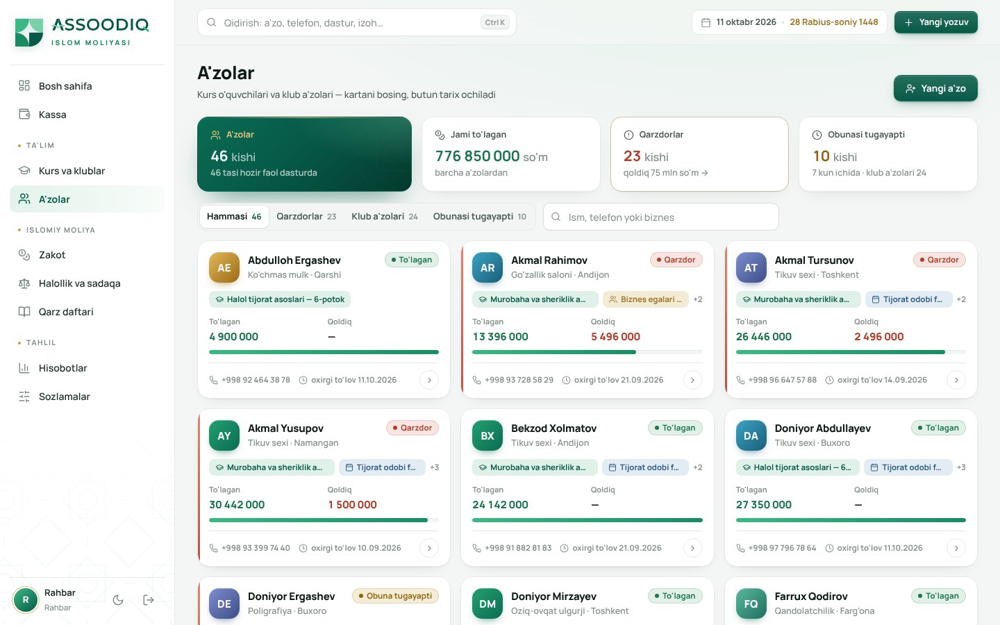
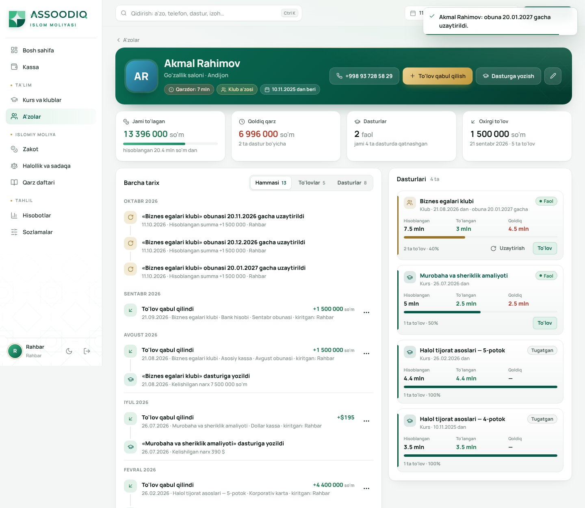
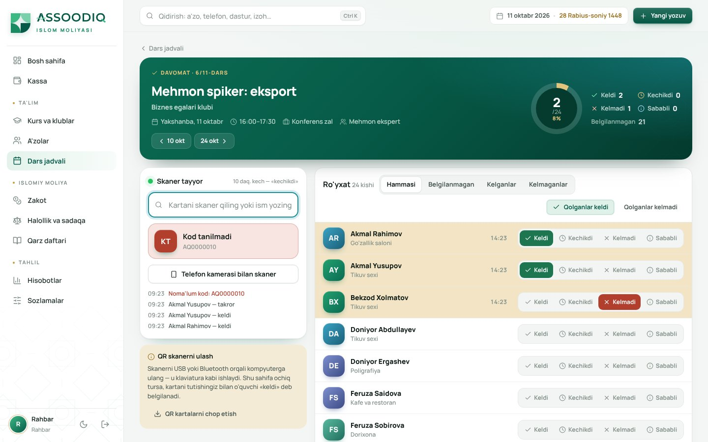
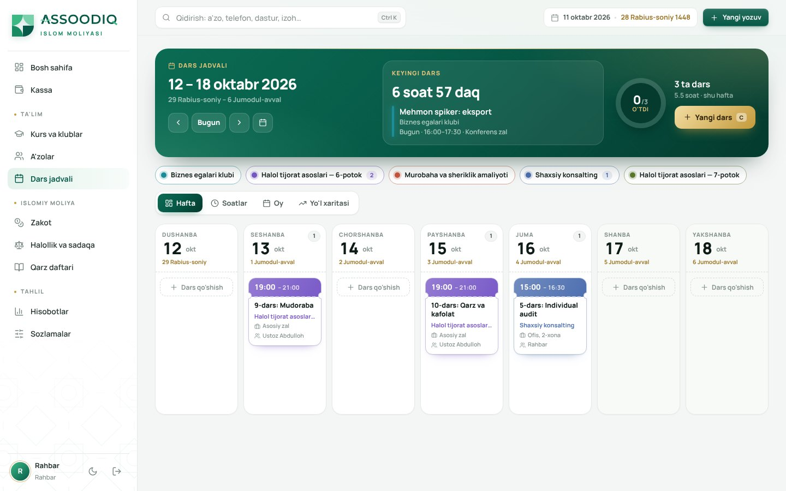
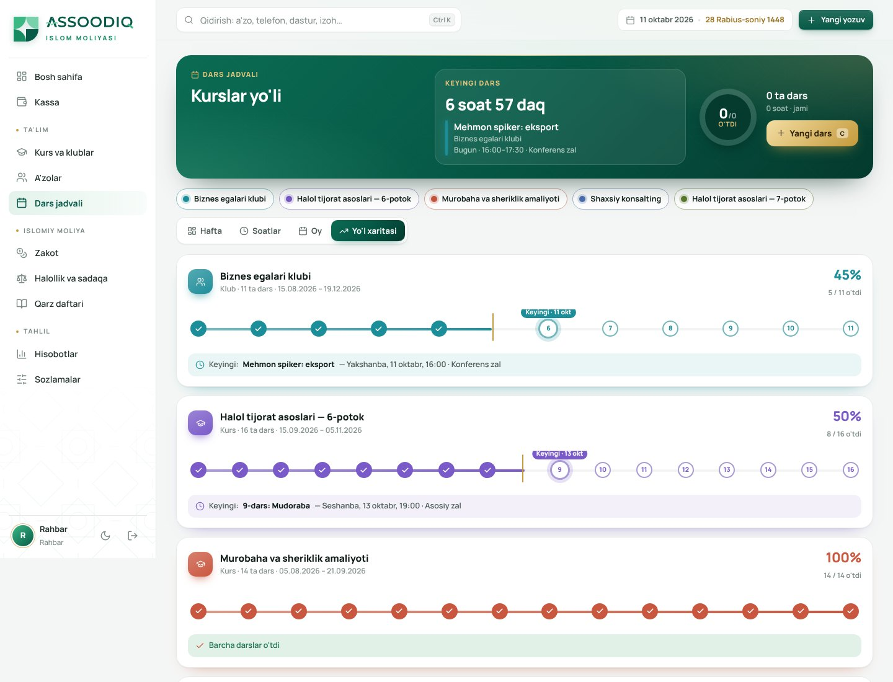

# Assoodiq — Islom moliyasi

Assoodiq'ning kurslari, klublari va kundalik moliyasini Google Sheets o'rniga yuritish uchun
dastur. Islom moliyasi qoidalari (zakot, tozalash, qarz daftari, aqd turlari) tizimning
ichiga qurilgan.


## Nima qila oladi

| Bo'lim | Vazifasi |
|---|---|
| **Bosh sahifa** | Umumiy balans, oy kirim/chiqim/sof foyda (o'tgan oyga nisbatan), 12 oylik grafik, hisoblar, zakot holati, undiriladigan summalar, diqqat talab qiladigan ishlar |
| **Kassa** | Hamma pul harakati bitta daftarda: kirim, chiqim, hisoblar orasidagi o'tkazma. **Jadval ko'rinishi** Sheets'dagi kassa daftari kabi: Kirim · Chiqim · Qoldiq ustunlari, oy boshi va oxiri qoldig'i, jami qatori. Jadval ostidagi **tez yozish qatori** (Enter — saqlash, `N` — shu qatorga o'tish), avval yozilgan ism tanlansa kategoriya va hisob o'zi to'ladi, qatorni ikki marta bosish — tahrirlash, «Nusxa olish». Oy, tur, hisob, kategoriya va matn bo'yicha filtr |
| **Sheets'dan ko'chirish** | Google Sheets / Excel'dan qatorlarni nusxa olib qo'yish yoki .xlsx/.csv yuklash. Ustunlar sarlavha bo'yicha taniladi (Sana, Summa yoki Kirim/Chiqim, Hisob, Kategoriya, Kimdan/kimga, Izoh…), har qator tekshiriladi, bazada bor yozuv ikkinchi marta qo'shilmaydi |
| **Dars jadvali** | «Darslar markazi»: zumrad bannerda keyingi darsgacha jonli sanoq, davr bo'yicha halqa (nechta dars o'tdi, necha soat), hijriy sanalar. Ko'rinishlar: **Hafta** — kunlar kartalarida dars chiptalari (chiptani boshqa kunga sudrab ko'chirish), **Soatlar** — vaqt to'ri (sudrash va cho'zish), **Oy**, **Yo'l xaritasi** — har kurs boshidan oxirigacha: o'tgan / keyingi / bekor darslar va «Bugun» belgisi. Takrorlanuvchi darslar, «N-dars» raqami, zal yoki o'qituvchi to'qnashuvi haqida ogohlantirish, seriyani tahrirlash/o'chirish. Klaviatura: C, T, ←/→, H/S/O/Y |
| **Davomat va QR skaner** | Har darsda davomat: keldi / kechikdi / kelmadi / sababli, «qolganlar keldi» bir bosishda. Har a'zoga QR kodli karta (A4 da 8 tadan chop etiladi, kod `AQ` + raqam + nazorat raqami). QR skaner USB/Bluetooth orqali klaviatura kabi ulanadi: davomat sahifasi ochiq tursa, karta tutilishi bilan «keldi» (10 daqiqadan kech — «kechikdi») belgilanadi, ovozli signal bilan; telefon kamerasi bilan skaner ham bor. O'quvchi kartasida va dastur sahifasida davomat foizi |
| **Telegram eslatmalar** | O'quvchilarga bot orqali avtomatik eslatma: darsdan N soat oldin (vaqti, joyi, ustozi bilan), obuna tugashidan N kun oldin va har oyning belgilangan kunida qarzdorlarga to'lov eslatmasi. Har biri bir marta yuboriladi (takror yo'q). Qo'lda: bitta o'quvchiga, butun dasturga yoki faqat qarzdorlarga xabar, darsdan «Eslatma yuborish». O'quvchi kartadagi shaxsiy havola/QR yoki telefon raqami orqali ulanadi; botda «📅 Jadval» va «💳 To'lov» tugmalari, /stop. Barcha xabarlar jurnali Sozlamalarda |
| **O'quvchi ilovasi** | `/app` manzilida alohida mobil ilova: telefonga o'rnatiladi (PWA) va Telegram bot ichida «Ilova» tugmasi bilan ochiladi (Mini App). Ichida: kurslar va o'quv dasturi (bo'lim → mavzu), video darslar, qayerda to'xtagani va progress, dars jadvali va davomat tarixi, to'lovlar va qoldiq, davomat uchun shaxsiy QR karta. Obunasi tugaganlarga darslar yopiladi («ochiq dars»lardan tashqari). Kirish: shaxsiy taklif havolasi/QR, Telegram'ga keladigan 6 xonali kod yoki Mini App orqali avtomatik |
| **Video darslar (Bunny Stream)** | «O'quv dasturi» bo'limida bo'lim va mavzular tuziladi, video brauzerdan to'g'ridan-to'g'ri Bunny'ga yuklanadi (katta fayl ham serverni band qilmaydi, uzilsa davom etadi). Ko'rish havolasi muddatli token bilan imzolanadi — boshqaga berib bo'lmaydi |
| **Namoz vaqtlari, qibla, zakot** | Ilovada: O'zbekiston shaharlari yoki GPS bo'yicha namoz vaqtlari (keyingi namozgacha teskari sanoq, haftalik jadval), telefon kompasi bilan qibla ko'rsatkichi, shaxsiy zakot kalkulyatori (oltin/kumush nisobi). Hisoblash usuli, asr mazhabi va har namozga daqiqa tuzatish — Sozlamalarda |
| **Sun'iy intellekt: Telegram yordamchi** | Xodim botga oddiy so'z bilan yozadi («Akmaldan 1.5 mln naqd kurs to'lovi oldim», «kecha ofis ijarasi 4 mln bankdan») yoki chek / nakladnoy / bank skrinshoti rasmini yuboradi — Claude summa, hisob, kategoriya, sana va o'quvchini aniqlaydi, bot qoralamani ko'rsatadi, «✅ Saqlash» bosilgandagina kassaga yoziladi (o'quvchi to'lovi uning qarziga bog'lanadi). Bir xabarda bir nechta yozuv. Menejer faqat kirim yozadi |
| **Sun'iy intellekt: moliyaviy tahlil** | Har hafta (kun va soat sozlanadi) rahbar va buxgalterga Telegram'da va bosh sahifada tahlil: asosiy raqamlar, yaxshi tomonlar, xavflar (qarzdorlar ismi bilan), «bu hafta 3 ta qadam». Botga savol ham beriladi: «Bu oy nega zarar?». Raqamlar dasturda hisoblanadi, sun'iy intellekt faqat tushuntiradi. Kunlik so'rov limiti va oylik xarajat Sozlamalarda ko'rinadi |
| **Kurs va klublar** | Har bir potok/klub/tadbir bo'yicha: a'zolar soni, kutilgan va yig'ilgan summa, xarajat, sof foyda, rentabellik, 1 a'zoni jalb qilish narxi |
| **A'zolar** | O'quvchi va klub a'zolari, kim qancha to'lagan va qancha qarz. Klub obunasini bir tugma bilan uzaytirish, muddati tugayotganlar ro'yxati |
| **Zakot** | Naqd, undiriladigan haqlar, tovar zaxirasi va qarzlar daftardan avtomatik yig'iladi. Nisob oltin (85 g) yoki kumush (595 g) bo'yicha. Havl sanasi hijriy taqvimda, hisob-kitoblar tarixi saqlanadi |
| **Halollik va sadaqa** | Shubhali yoki nohalol tushumlar «tozalash fondi»ga ajratiladi va foydaga qo'shilmaydi. Sof foydadan sadaqa rejasi. Daromadning aqd turlari bo'yicha taqsimoti |
| **Qarz daftari** | Baqara 282 asosida: berilgan va olingan qarzlar, muddat, guvoh, qisman qaytarish. Qarzga foiz qo'shilmaydi, qarz foyda-zararga kirmaydi |
| **Hisobotlar** | Yillik foyda-zarar jadvali (guruh × oy), Excel'ga eksport, dasturlar iqtisodiyoti |
| **Nazorat** | Kassa yozuvini tahrirlash (kim nimani o'zgartirgani tarixda qoladi), kassani Excel'ga eksport, barcha ma'lumotlarning zaxira nusxasi, "O'zgarishlar tarixi" bo'limi |
| **Sozlamalar** | Dollar kursi, oltin/kumush narxi, hisoblar, kategoriyalar, xodimlar va ularning 6 xonali kirish kodlari |

**Rollar:** *rahbar* hamma bo'limni ko'radi va xodim qo'sha oladi. *Buxgalter* xodimlar
boshqaruvidan tashqari hamma narsani ko'radi. *Menejer* faqat dasturlar, a'zolar va kirim
bilan ishlaydi: chiqim yoza olmaydi va yozuvni o'chira olmaydi.

## Ishga tushirish

```bash
python -m venv .venv && source .venv/bin/activate      # Windows: .venv\Scripts\activate
pip install -r requirements.txt
python seed.py --demo        # bo'sh baza + 12 oylik namuna ma'lumot
python app.py                # http://localhost:5070
```

Haqiqiy ish uchun namunasiz boshlang: `python seed.py`. Bu buyruq faqat hisoblar,
kategoriyalar va xodimlarni yaratadi.

**Boshlang'ich kirish kodlari** (birinchi kirishdan keyin Sozlamalar → Xodimlar orqali
almashtiring):

| Rol | Kod |
|---|---|
| Rahbar | `100100` |
| Buxgalter | `200200` |
| Menejer | `300300` |

**Testlar:** `python -m pytest -q`

## Railway'ga joylash

`railway.json` va `Procfile` tayyor. Ilova birinchi ishga tushganda bo'sh bazaga hisoblar,
kategoriyalar va bitta **rahbar**ni o'zi yaratadi, `seed.py`ni ishga tushirish shart emas.

1. Loyiha canvasida **+ Add → Database → PostgreSQL** qo'shing. Busiz yozuvlar konteyner
   diskiga tushadi va har deployda o'chib ketadi.
2. Assoodiq servisi → **Variables**:
   - `DATABASE_URL` = `${{Postgres.DATABASE_URL}}`
   - `ADMIN_CODE` = rahbarning 6 xonali kirish kodi (o'zingiz o'ylab toping)
   - `SESSION_COOKIE_SECURE` = `1`
3. **Settings → Networking → Generate Domain**.
4. Rahbar kodi bilan kiring. Sozlamalar → Xodimlar'da buxgalter va menejerlarni qo'shing,
   har biriga tizim kod beradi.
5. *(ixtiyoriy)* **Telegram.** [@BotFather](https://t.me/BotFather) da `/newbot` bilan bot
   yarating. Sozlamalar → Telegram'da tokenni kiritib, «Botni saytga ulash»ni bosing. Token
   o'rniga `TELEGRAM_BOT_TOKEN` o'zgaruvchisini ham berish mumkin. Eslatmalarni har daqiqada
   ilova ichidagi fon oqimi tekshiradi (bitta gunicorn worker yetarli; `TELEGRAM_SCHEDULER=0` —
   o'chiradi).
6. *(ixtiyoriy)* **Sun'iy intellekt.** [console.anthropic.com](https://console.anthropic.com) da API kalit
   yarating va Sozlamalar → Sun'iy intellekt'ga kiriting (yoki `ANTHROPIC_API_KEY`). Har bir xodim
   chap menyudagi «Telegram yordamchi» orqali o'z Telegram'ini ulaydi. Telegram bot ilgari ulangan
   bo'lsa, «Botni saytga ulash»ni bir marta qayta bosing (tasdiqlash tugmalari uchun).
7. *(ixtiyoriy)* **Video darslar.** [bunny.net](https://bunny.net/stream/) da Stream kutubxonasi
   oching. Sozlamalar → O'quvchi ilovasi'ga Library ID, API Key va (Security bo'limidagi)
   Token authentication key'ni kiriting. Bunny'da «Embed view token authentication»ni yoqing.
   Ilova manzili: `https://<domen>/app/` — Telegram bot ulangan bo'lsa, botning menyusida
   «Ilova» tugmasi o'zi paydo bo'ladi.

**Test rejimi.** Sozlamalar → Ma'lumotlar bo'limida rahbar bo'sh bazaga 12 oylik namuna
ma'lumot yuklaydi (8 dastur, 46 a'zo, kirim-chiqim, qarz, zakot). Test rejimida har sahifada
ogohlantirish chiqadi. Haqiqiy ishdan oldin shu bo'limda `TOZALASH` deb yozib, barcha
yozuvlarni o'chirasiz. Xodimlar, hisoblar va kategoriyalar saqlanadi.

`ADMIN_CODE` berilmasa, tasodifiy kod yaratiladi va **Deploy Logs**'ga
`[assoodiq] ... kirish kodi: ...` qatori bilan yoziladi. Sessiya kaliti (`SECRET_KEY`)
berilmasa, bazada saqlanadigan tasodifiy kalit ishlatiladi.

## Tuzilishi

```
app.py              Flask ilova, filtrlar (pul formati, hijriy sana), rollar bo'yicha kirish
config.py           Sozlama (SQLite yoki DATABASE_URL)
seed.py             Boshlang'ich kategoriyalar va namuna ma'lumot
core/
  models.py         Ma'lumotlar modeli (Transaction — yagona daftar)
  finance.py        Barcha hisob-kitob: balans, foyda-zarar, dastur iqtisodiyoti, zakot, fondlar
  hijri.py          Hijriy taqvim (jadval usuli) va havl sanasi
  attendance.py     Davomat: a'zo QR kodi, dars ro'yxati, belgilash va statistika
  calendar.py       Dars jadvali: haftalik takrorlash, kun ichida joylashtirish, to'qnashuvlar
  student.py        O'quvchi ilovasi: kirish (taklif, kod, Mini App imzosi), kurslar va progress
  prayer.py         Namoz vaqtlari (astronomik hisob), qibla yo'nalishi va masofasi
  bunny.py          Bunny Stream: video yaratish, TUS yuklash imzosi, himoyalangan ko'rish havolasi
  ai.py             Claude bilan ishlash: so'rov, xarajat hisobi, kunlik limit
  ai_kassa.py       Matn/chek rasmi → tekshirilgan kassa qoralamasi → tasdiqlangach yozuv
  ai_report.py      Moliyaviy raqamlar to'plami, haftalik tahlil va savollarga javob
  staff_bot.py      Telegram botning xodimlar rejimi (ulash, tasdiqlash tugmalari, /balans, /hisobot)
  telegram.py       Telegram bot: yuborish, shablonlar, avtomatik eslatmalar, webhook buyruqlari
  sheets.py         Google Sheets / Excel'dan import: ustunlarni tanish, summa va sana formatlari, takrorlar
views/              Bo'limlar: kassa, dastur, qarz, islomiy, hisobot, sozlama, auth
templates/          Jinja shablonlari; partials/ui.html — umumiy bo'laklar (ikonka, grafik, oynalar)
static/             CSS (yorug'/qorong'i mavzu tokenlari), JS, logotip va naqsh
tests/              pytest
```

**Asosiy tamoyil:** har bir pul harakati bitta `Transaction` daftariga yoziladi. Balans,
foyda-zarar, kurs foydasi, qarz qoldig'i, zakot va tozalash fondi shu daftardan hisoblanadi,
hech bir raqam ikki joyda qo'lda yozilmaydi. Dollardagi yozuv o'sha kungi kurs bo'yicha
so'mdagi qiymati bilan saqlanadi, shuning uchun kurs o'zgarsa ham o'tgan oylar hisoboti
o'zgarmaydi.

## Xavfsizlik

- 6 xonali kod bilan kirish; bir IP'dan 10 daqiqada 8 marta xato — vaqtincha bloklanadi
- Sessiya cookie: `HttpOnly`, `SameSite=Lax`, HTTPS'da `Secure`; kalit bazada saqlanadi
- Boshqa saytdan yuborilgan o'zgartiruvchi so'rovlar (CSRF) `Origin` tekshiruvi bilan rad etiladi
- `X-Frame-Options`, `Referrer-Policy`, moliyaviy sahifalarda `Cache-Control: no-store`
- O'quvchi ilovasi xodimlar panelidan alohida sessiya bilan ishlaydi; taklif havolasi bazada faqat
  xesh ko'rinishida saqlanadi, «barcha qurilmalardan chiqarish» eski havola va sessiyalarni bekor qiladi
- Sun'iy intellekt kassaga o'zi yozmaydi: har bir yozuv xodim tasdiqlagach saqlanadi, maydonlar
  bazaga qarab qayta tekshiriladi; javoblardagi HTML faqat `<b>`/`<i>` bilan cheklanadi
- Telegram Mini App kirishi `initData` imzosini bot tokeni bilan tekshiradi; kirish kodi 10 daqiqa,
  5 urinish; Bunny API kaliti brauzerga hech qachon berilmaydi
- Telegram webhook maxfiy manzil va `X-Telegram-Bot-Api-Secret-Token` sarlavhasi bilan tekshiriladi
- Rollar server tomonda tekshiriladi (menejer chiqim/tahrir/eksport/dastur narxini o'zgartira olmaydi)

## Shariat bo'yicha qabul qilingan qoidalar (tasdiqlash kerak)

Quyidagi qoidalar Hanafiy mazhabidagi tijorat zakoti uslubiga asoslangan. Ishga
tushirishdan oldin Assoodiq'ning shariat maslahatchisi bilan ko'rib chiqing:

1. Zakot = (naqd + undiriladigan haqlar + tovar zaxirasi + boshqa tijorat aktivlari − muddati kelgan qarzlar) × 2,5%. Bu qiymat nisobdan kam bo'lmasa va havl to'lgan bo'lsa hisoblanadi.
2. O'quvchilarning to'lanmagan kurs pullari «kuchli qarz» (dayn qaviy) sifatida undiriladigan haqlarga qo'shiladi. Zakot sahifasida qo'lda o'zgartirish mumkin.
3. Tozalash fondidagi pul egasiniki hisoblanmaydi: zakot hisobida naqd puldan ayiriladi, foyda-zararga
   ham kirmaydi (shubhali/nohalol tushum ham, uni chiqarish ham).
4. Nisob boshlang'ich holatda oltin (85 g) bo'yicha, Sozlamalarda kumushga o'tkazish mumkin.
5. Hijriy sana jadval usulida hisoblanadi va rasmiy e'londan 1–2 kun farq qilishi mumkin.

## Keyingi bosqichlar

- **Google Sheets bilan sinxron.** Hozir qo'lda nusxa olib ko'chiriladi; kerak bo'lsa Sheets'ni
  to'g'ridan-to'g'ri ulab, o'tish davrida avtomatik sinxronlash.
- **Telegram bot (xodimlar uchun).** O'quvchilarga eslatmalar tayyor; keyingisi — rahbarga
  kunlik hisobot va chiqimni bot orqali tez kiritish.
- **Sheriklik hisobi.** Mushoraka va mudoraba asosida ta'sischilar o'rtasida foydani taqsimlash
  (sheriklar soni va nisbatlari aniqlangach).
- **To'lov tizimlari.** Payme/Click to'lovlarini avtomatik qabul qilish.
- **Brend.** Assoodiq logotipi vektor (SVG) ko'rinishda qayta chizilgan: `static/img/mark.svg`
  (belgi), `wordmark.svg` / `wordmark-light.svg` (yozuv), `favicon.svg`. Rasmiy logo fayli
  (SVG/AI) bo'lsa, shu fayllar bilan almashtirish kifoya. Generator: `scripts/make_logo.py`.

## Ko'rinishlar

| | |
|---|---|
|  |  |
|  |  |
|  |  |
|  |  |
|  | |
|  |  |
|  |  |
|  |  |
