# Assoodiq — Islom moliyasi

Assoodiq'ning kurslari, klublari va kundalik moliyasini Google Sheets o'rniga yuritish uchun
dastur. Islom moliyasi qoidalari (zakot, tozalash, qarz daftari, aqd turlari) tizimning
ichiga qurilgan.

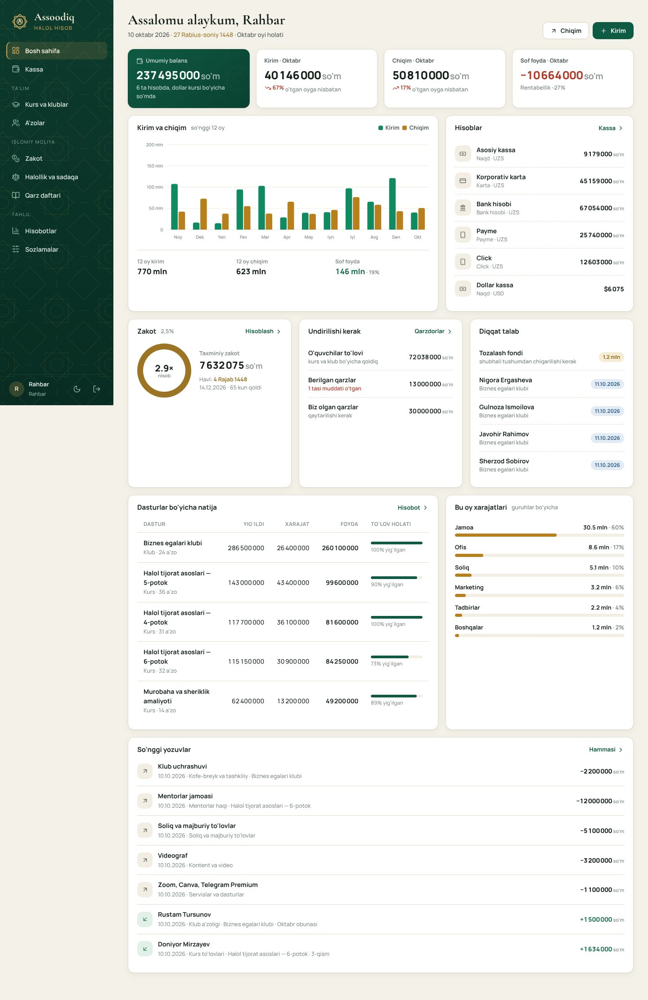

## Nima qila oladi

| Bo'lim | Vazifasi |
|---|---|
| **Bosh sahifa** | Umumiy balans, oy kirim/chiqim/sof foyda (o'tgan oyga nisbatan), 12 oylik grafik, hisoblar, zakot holati, undiriladigan summalar, diqqat talab qiladigan ishlar |
| **Kassa** | Hamma pul harakati bitta daftarda: kirim, chiqim, hisoblar orasidagi o'tkazma. **Jadval ko'rinishi** Sheets'dagi kassa daftari kabi: Kirim · Chiqim · Qoldiq ustunlari, oy boshi va oxiri qoldig'i, jami qatori. Jadval ostidagi **tez yozish qatori** (Enter — saqlash, `N` — shu qatorga o'tish), avval yozilgan ism tanlansa kategoriya va hisob o'zi to'ladi, qatorni ikki marta bosish — tahrirlash, «Nusxa olish». Oy, tur, hisob, kategoriya va matn bo'yicha filtr |
| **Sheets'dan ko'chirish** | Google Sheets / Excel'dan qatorlarni nusxa olib qo'yish yoki .xlsx/.csv yuklash. Ustunlar sarlavha bo'yicha taniladi (Sana, Summa yoki Kirim/Chiqim, Hisob, Kategoriya, Kimdan/kimga, Izoh…), har qator tekshiriladi, bazada bor yozuv ikkinchi marta qo'shilmaydi |
| **Kurs va klublar** | Har bir potok/klub/tadbir bo'yicha: a'zolar soni, kutilgan va yig'ilgan summa, xarajat, sof foyda, rentabellik, 1 a'zoni jalb qilish narxi |
| **A'zolar** | O'quvchi va klub a'zolari, kim qancha to'lagan va qancha qarz. Klub obunasini bir tugma bilan uzaytirish, muddati tugayotganlar ro'yxati |
| **Zakot** | Naqd, undiriladigan haqlar, tovar zaxirasi va qarzlar daftardan avtomatik yig'iladi. Nisob oltin (85 g) yoki kumush (595 g) bo'yicha. Havl sanasi hijriy taqvimda, hisob-kitoblar tarixi saqlanadi |
| **Halollik va sadaqa** | Shubhali yoki nohalol tushumlar «tozalash fondi»ga ajratiladi va foydaga qo'shilmaydi. Sof foydadan sadaqa rejasi. Daromadning aqd turlari bo'yicha taqsimoti |
| **Qarz daftari** | Baqara 282 asosida: berilgan va olingan qarzlar, muddat, guvoh, qisman qaytarish. Qarzga foiz qo'shilmaydi, qarz foyda-zararga kirmaydi |
| **Hisobotlar** | Yillik foyda-zarar jadvali (guruh × oy), Excel'ga eksport, dasturlar iqtisodiyoti |
| **Nazorat** | Kassa yozuvini tahrirlash (kim nimani o'zgartirgani tarixda qoladi), kassani Excel'ga eksport, barcha ma'lumotlarning zaxira nusxasi, "O'zgarishlar tarixi" bo'limi |
| **Sozlamalar** | Dollar kursi, oltin/kumush narxi, hisoblar, kategoriyalar, xodimlar va ularning 6 xonali kirish kodlari |

**Rollar:** *rahbar* hamma bo'limni ko'radi va xodim qo'sha oladi. *Buxgalter* xodimlar
boshqaruvidan tashqari hamma narsani ko'radi. *Menejer* faqat dasturlar, a'zolar va kirim
bilan ishlaydi: chiqim yoza olmaydi va yozuvni o'chira olmaydi.

## Ishga tushirish

```bash
python -m venv .venv && source .venv/bin/activate      # Windows: .venv\Scripts\activate
pip install -r requirements.txt
python seed.py --demo        # bo'sh baza + 12 oylik namuna ma'lumot
python app.py                # http://localhost:5070
```

Haqiqiy ish uchun namunasiz boshlang: `python seed.py`. Bu buyruq faqat hisoblar,
kategoriyalar va xodimlarni yaratadi.

**Boshlang'ich kirish kodlari** (birinchi kirishdan keyin Sozlamalar → Xodimlar orqali
almashtiring):

| Rol | Kod |
|---|---|
| Rahbar | `100100` |
| Buxgalter | `200200` |
| Menejer | `300300` |

**Testlar:** `python -m pytest -q`

## Railway'ga joylash

`railway.json` va `Procfile` tayyor. Ilova birinchi ishga tushganda bo'sh bazaga hisoblar,
kategoriyalar va bitta **rahbar**ni o'zi yaratadi, `seed.py`ni ishga tushirish shart emas.

1. Loyiha canvasida **+ Add → Database → PostgreSQL** qo'shing. Busiz yozuvlar konteyner
   diskiga tushadi va har deployda o'chib ketadi.
2. Assoodiq servisi → **Variables**:
   - `DATABASE_URL` = `${{Postgres.DATABASE_URL}}`
   - `ADMIN_CODE` = rahbarning 6 xonali kirish kodi (o'zingiz o'ylab toping)
   - `SESSION_COOKIE_SECURE` = `1`
3. **Settings → Networking → Generate Domain**.
4. Rahbar kodi bilan kiring. Sozlamalar → Xodimlar'da buxgalter va menejerlarni qo'shing,
   har biriga tizim kod beradi.

**Test rejimi.** Sozlamalar → Ma'lumotlar bo'limida rahbar bo'sh bazaga 12 oylik namuna
ma'lumot yuklaydi (8 dastur, 46 a'zo, kirim-chiqim, qarz, zakot). Test rejimida har sahifada
ogohlantirish chiqadi. Haqiqiy ishdan oldin shu bo'limda `TOZALASH` deb yozib, barcha
yozuvlarni o'chirasiz. Xodimlar, hisoblar va kategoriyalar saqlanadi.

`ADMIN_CODE` berilmasa, tasodifiy kod yaratiladi va **Deploy Logs**'ga
`[assoodiq] ... kirish kodi: ...` qatori bilan yoziladi. Sessiya kaliti (`SECRET_KEY`)
berilmasa, bazada saqlanadigan tasodifiy kalit ishlatiladi.

## Tuzilishi

```
app.py              Flask ilova, filtrlar (pul formati, hijriy sana), rollar bo'yicha kirish
config.py           Sozlama (SQLite yoki DATABASE_URL)
seed.py             Boshlang'ich kategoriyalar va namuna ma'lumot
core/
  models.py         Ma'lumotlar modeli (Transaction — yagona daftar)
  finance.py        Barcha hisob-kitob: balans, foyda-zarar, dastur iqtisodiyoti, zakot, fondlar
  hijri.py          Hijriy taqvim (jadval usuli) va havl sanasi
  sheets.py         Google Sheets / Excel'dan import: ustunlarni tanish, summa va sana formatlari, takrorlar
views/              Bo'limlar: kassa, dastur, qarz, islomiy, hisobot, sozlama, auth
templates/          Jinja shablonlari; partials/ui.html — umumiy bo'laklar (ikonka, grafik, oynalar)
static/             CSS (yorug'/qorong'i mavzu tokenlari), JS, logotip va naqsh
tests/              pytest
```

**Asosiy tamoyil:** har bir pul harakati bitta `Transaction` daftariga yoziladi. Balans,
foyda-zarar, kurs foydasi, qarz qoldig'i, zakot va tozalash fondi shu daftardan hisoblanadi,
hech bir raqam ikki joyda qo'lda yozilmaydi. Dollardagi yozuv o'sha kungi kurs bo'yicha
so'mdagi qiymati bilan saqlanadi, shuning uchun kurs o'zgarsa ham o'tgan oylar hisoboti
o'zgarmaydi.

## Xavfsizlik

- 6 xonali kod bilan kirish; bir IP'dan 10 daqiqada 8 marta xato — vaqtincha bloklanadi
- Sessiya cookie: `HttpOnly`, `SameSite=Lax`, HTTPS'da `Secure`; kalit bazada saqlanadi
- Boshqa saytdan yuborilgan o'zgartiruvchi so'rovlar (CSRF) `Origin` tekshiruvi bilan rad etiladi
- `X-Frame-Options`, `Referrer-Policy`, moliyaviy sahifalarda `Cache-Control: no-store`
- Rollar server tomonda tekshiriladi (menejer chiqim/tahrir/eksport/dastur narxini o'zgartira olmaydi)

## Shariat bo'yicha qabul qilingan qoidalar (tasdiqlash kerak)

Quyidagi qoidalar Hanafiy mazhabidagi tijorat zakoti uslubiga asoslangan. Ishga
tushirishdan oldin Assoodiq'ning shariat maslahatchisi bilan ko'rib chiqing:

1. Zakot = (naqd + undiriladigan haqlar + tovar zaxirasi + boshqa tijorat aktivlari − muddati kelgan qarzlar) × 2,5%. Bu qiymat nisobdan kam bo'lmasa va havl to'lgan bo'lsa hisoblanadi.
2. O'quvchilarning to'lanmagan kurs pullari «kuchli qarz» (dayn qaviy) sifatida undiriladigan haqlarga qo'shiladi. Zakot sahifasida qo'lda o'zgartirish mumkin.
3. Tozalash fondidagi pul egasiniki hisoblanmaydi: zakot hisobida naqd puldan ayiriladi, foyda-zararga
   ham kirmaydi (shubhali/nohalol tushum ham, uni chiqarish ham).
4. Nisob boshlang'ich holatda oltin (85 g) bo'yicha, Sozlamalarda kumushga o'tkazish mumkin.
5. Hijriy sana jadval usulida hisoblanadi va rasmiy e'londan 1–2 kun farq qilishi mumkin.

## Keyingi bosqichlar

- **Google Sheets bilan sinxron.** Hozir qo'lda nusxa olib ko'chiriladi; kerak bo'lsa Sheets'ni
  to'g'ridan-to'g'ri ulab, o'tish davrida avtomatik sinxronlash.
- **Telegram bot.** Chiqimni tez kiritish, kunlik hisobot, qarzdorlarga va obunasi tugayotganlarga eslatma.
- **Sheriklik hisobi.** Mushoraka va mudoraba asosida ta'sischilar o'rtasida foydani taqsimlash
  (sheriklar soni va nisbatlari aniqlangach).
- **To'lov tizimlari.** Payme/Click to'lovlarini avtomatik qabul qilish.
- **Brend.** Assoodiq logotipi vektor (SVG) ko'rinishda qayta chizilgan: `static/img/mark.svg`
  (belgi), `wordmark.svg` / `wordmark-light.svg` (yozuv), `favicon.svg`. Rasmiy logo fayli
  (SVG/AI) bo'lsa, shu fayllar bilan almashtirish kifoya. Generator: `scripts/make_logo.py`.

## Ko'rinishlar

| | |
|---|---|
| 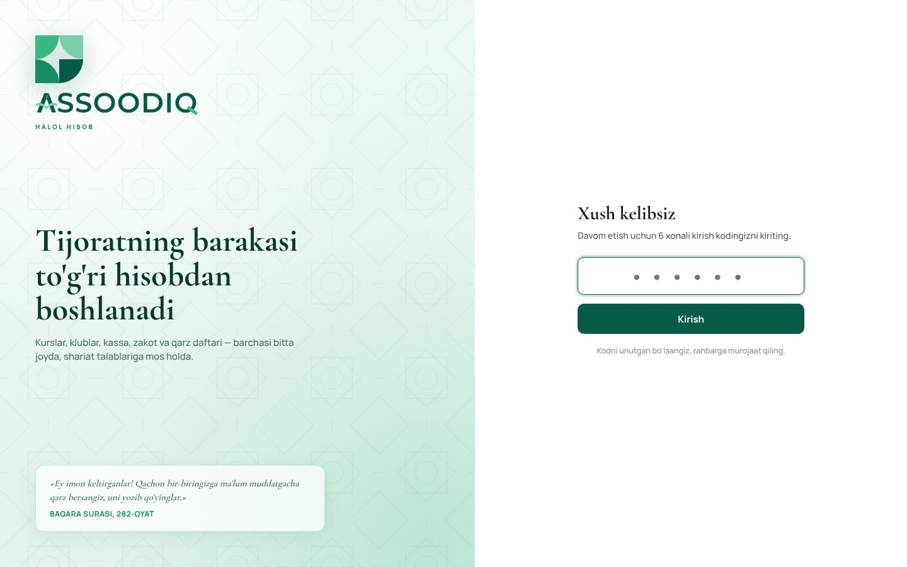 | 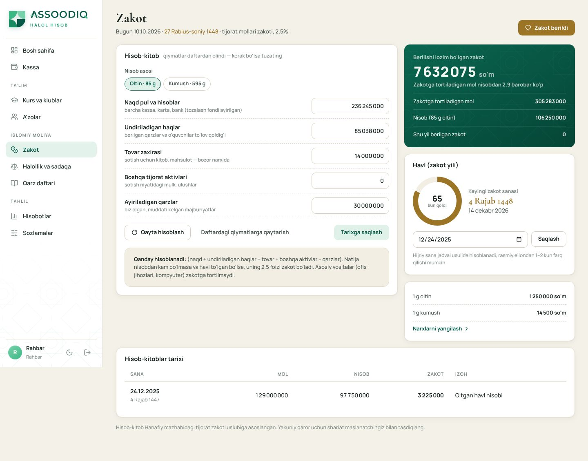 |
| 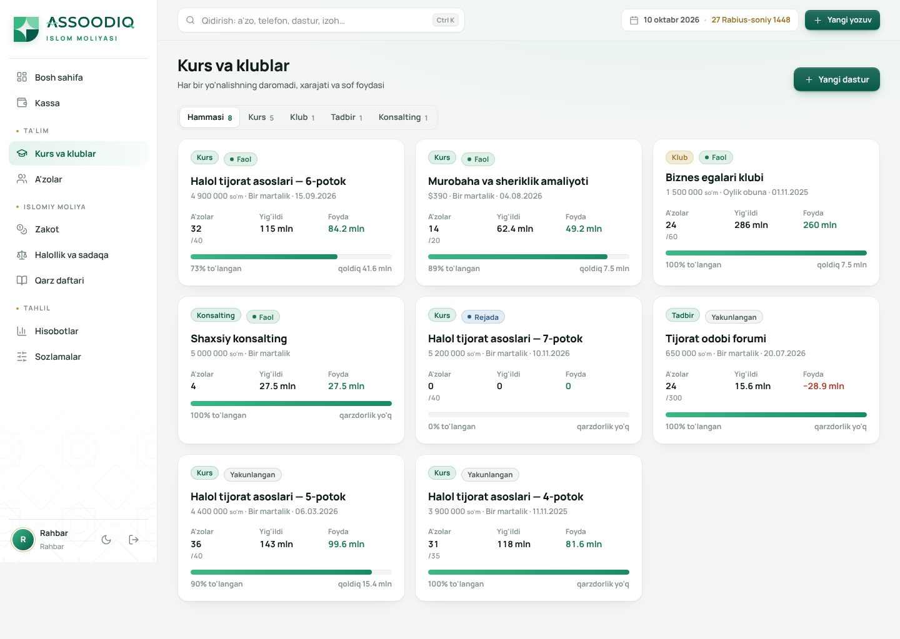 | 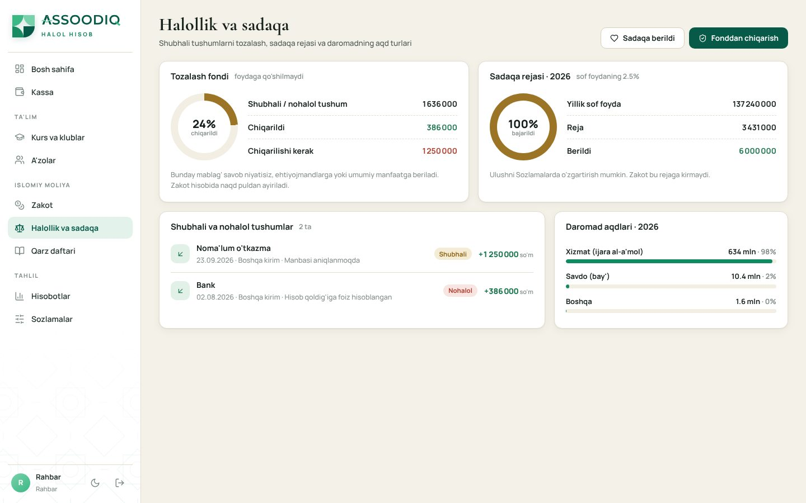 |
| 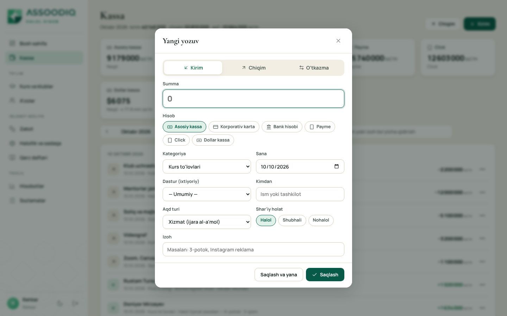 | 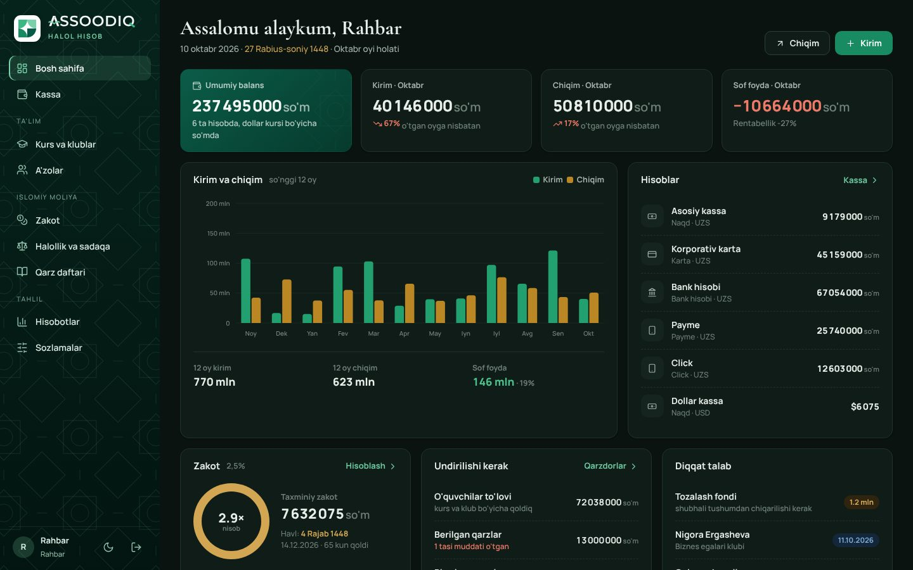 |
| 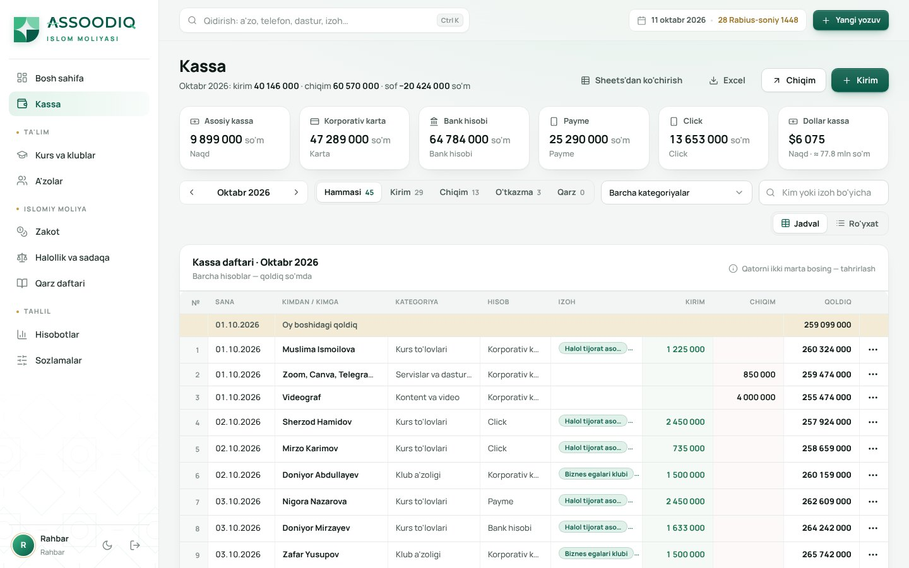 | 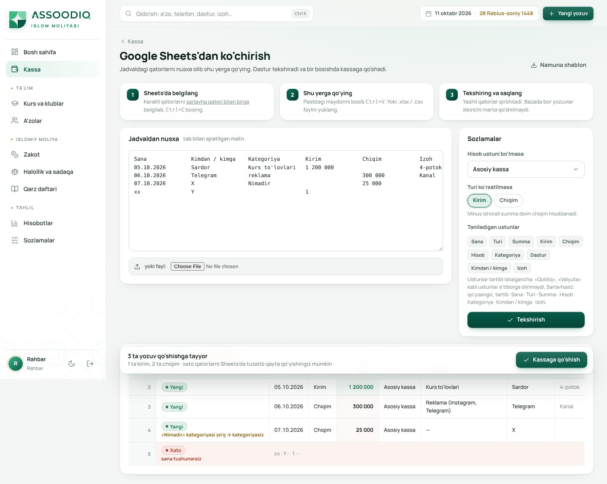 |
| 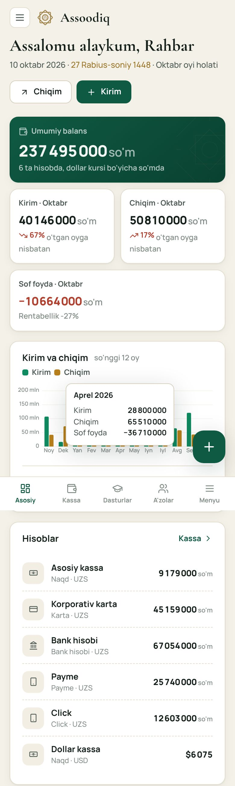 | 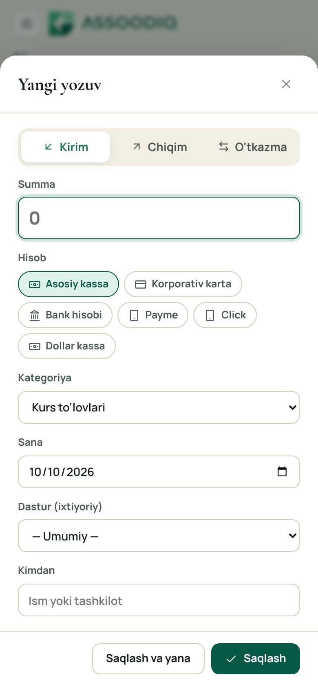 |
